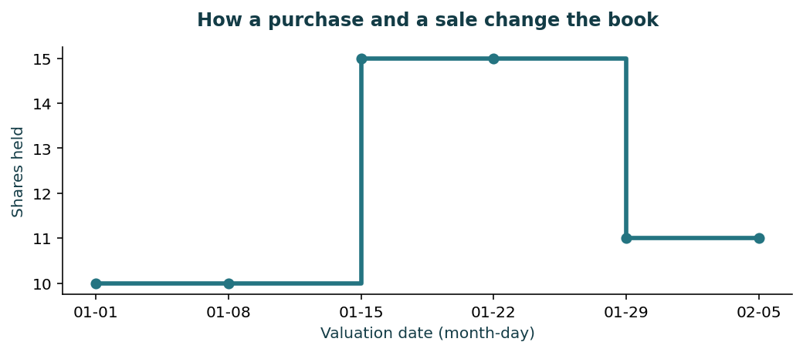

# StratLedger

StratLedger follows a simulated investment portfolio from a strategy decision to the return on the book. A Streamlit dashboard connects market data, transactions and portfolio-level risk metrics through a local SQLite database.

## Client and strategy workflow

The dashboard opens on a small offline ledger. In **Portfolio simulator** I can select a sample client, review the assigned equities, bonds and ETFs, generate strategy transactions, and inspect the buys and sells in SQLite. The market-data view compares closing prices and base-100 paths. The holdings and performance views reconstruct each valuation date, show the composition, and compare weekly risk against a selected ETF such as SPY or QQQ.

The decision rules use the price history available through the trading date. I calculate daily log returns in chronological order, then present the observations newest first to the trading rules. For the low-risk rule, the risk input is the sample standard deviation of the most recent 30 log returns annualised with 252 trading days.

```math
\ell_t=\log(P_t/P_{t-1}),\qquad \widehat\sigma_{30}=\sqrt{252}\,\mathrm{sd}(\ell_{t-29},\ldots,\ell_t).
```

| Strategy | A decision you can follow in the code |
| --- | --- |
| Low risk | A new buy requires positive 10- and 30-observation average log returns and volatility below 12%. The rule also checks reductions on existing positions. |
| Low turnover | On the first and third scheduled Mondays, compare the five- and twenty-observation means. At most one trade can be booked on each eligible date. |
| High-yield equity | A new equity position requires positive five-, ten- and thirty-observation means and volatility below 40%. Separate sell conditions handle an existing position. |

The lookback and the annualisation can be checked with a dated price series whose log returns are known. [Decision and sizing rules](strategies.py) · [Dated-history regression check](tests/test_strategy_history.py) · [Ledger generation](ledger_service.py)

### A decision on historical prices

I replayed the two equity rules on **29 December 2023** with empty starting positions and the five adjusted-price histories used in ParisTape. The low-risk rule generated buys of 20 shares each in L'Oréal and Schneider Electric. The high-yield equity rule generated buys of 25 shares each in those two stocks and Sanofi. These are decisions at one historical close. The six-week ledger below is a separate test of how booked trades flow into holdings.

| Equity | Average daily log return over 10 observations | 30-observation annualised volatility | New positions proposed |
| --- | ---: | ---: | --- |
| Air Liquide | −0.164% | 10.32% | Neither rule |
| L'Oréal | +0.116% | 8.02% | Both rules |
| Schneider Electric | +0.291% | 11.74% | Both rules |
| LVMH | −0.012% | 18.91% | Neither rule |
| Sanofi | +0.137% | 12.56% | High-yield equity only |

Sanofi is a useful boundary case. Its five-, ten- and thirty-observation means were positive, but its 12.56% volatility exceeded the low-risk entry threshold of 12%. The high-yield rule allowed it. [Historical price window](https://github.com/TomBussard/ParisTape#how-a-point-appears-on-the-chart) · [Strategy implementation](strategies.py)

## What you can do

Create a sample client, choose a risk profile and compare the low-risk, low-turnover and high-yield strategy rules. Inspect the resulting trades, positions and weekly performance. The dashboard reports volatility, Sharpe ratio and maximum drawdown.

The [strategy rules](strategies.py) determine which trades to book. The [portfolio analyser](performances.py) reconstructs positions and calculates returns. Historical prices are requested through Yahoo Finance, so data availability can affect a run.

## Reconstruct a position

I used a six-week example to check how the ledger handles successive trades in the same stock. The account bought ten shares, added five and sold four. It finished with **11 shares** worth **1,122** at the final simulated price of 102. The chart shows shares held, so changes in the quote cannot be mistaken for a trade. [Reproducible example](example.py)



## From a trade to a weekly valuation

| Week | Ledger event | Shares held | Closing price | Holdings value |
| --- | --- | ---: | ---: | ---: |
| 1 | Buy 10 | 10 | 100 | 1,000 |
| 3 | Buy 5 | 15 | 101 | 1,515 |
| 5 | Sell 4 | 11 | 105 | 1,155 |
| 6 | No trade | 11 | 102 | 1,122 |

I store deals as dated quantities in SQLite. For asset $i$, let $q_{i,k}$ be the signed quantity on trade $k$, positive for a buy and negative for a sale. At each Monday cutoff $t$ I reconstruct the position $Q_{i,t}$ and look up the most recent close $P_{i,t}$ available on or before that date. The holdings value $H_t$ sums the positions I can price.

```math
Q_{i,t}=\sum_{k:\,t_k\le t}q_{i,k},\qquad H_t=\sum_i Q_{i,t}P_{i,t}
```

### How much of a weekly move came from trading?

For one stock the change in holdings value splits exactly into the price move on the opening shares and the change in shares valued at the new close.

```math
H_t-H_{t-1}=Q_{t-1}(P_t-P_{t-1})+(Q_t-Q_{t-1})P_t
```

In week 2 the account held ten shares at 104. In week 3 the price fell to 101, costing **30** on the opening position. The five new shares added **505** at that week's close. Holdings therefore rose by **475**, from **1,040 to 1,515**, even though the stock fell. In the final week the account held 11 shares throughout, so the drop from 105 to 102 explains the entire **33** decline.

The simulator calculates weekly percentage changes in holdings value and clips them to the range from −10% to +10% before computing its risk metrics. In the purchase week, a raw increase of 45.67% therefore enters those metrics as 10%. The ledger example displays the actual holdings values. An investor return across buys and sells would also need cash movements and trade proceeds. [Position reconstruction and weekly metrics](performances.py) · [Six-week ledger](example.py)

The dashboard opens with this example and creates its ledger in a temporary directory. Choose **Portfolio simulator** for the sample-client database. Its low-risk, low-turnover and high-yield equity rules feed the same holdings workflow. [Database schema](database_manager.py) · [Connections and transaction generation](ledger_service.py) · [Weekly valuation and performance](performances.py)

## From five weekly observations to the dashboard metrics

I ran the six-week ledger through the same performance analyser used by the simulator. It starts with six Monday holdings values and produces five weekly observations. Let $u_t$ denote the weekly change in holdings value after applying the dashboard's 10% cap in either direction. The displayed growth index starts at one, and drawdown is measured from its previous peak, including that initial value.

```math
u_t=\min(0.10,\max(-0.10,H_t/H_{t-1}-1)),\qquad W_t=\prod_{j=1}^t(1+u_j).
```

```math
DD_t=\frac{W_t}{\max(1,W_1,\ldots,W_t)}-1.
```

| Weekly statistic | Six-week ledger run |
| --- | ---: |
| Five observations in date order | +4.00%, +10.00%, −2.97%, −10.00%, −2.86% |
| Cumulative change of the clipped series | −2.95% |
| Maximum drawdown of that series | −15.17% |
| Annualised volatility | 54.96% |

For $m$ weekly observations the dashboard compounds to an annual rate, scales weekly sample volatility by $\sqrt{52}$ and uses a 2% annual risk-free rate in its Sharpe calculation.

```math
R_a=W_m^{52/m}-1,\qquad \sigma_a=\sqrt{52}\,\mathrm{sd}(u),\qquad
S=(R_a-0.02)/\sigma_a.
```

Here $S=-0.524$. Five observations are enough to check the implementation, but annualising them magnifies transfers into and out of holdings. The original share counts and unadjusted market values remain visible in the ledger. [Weekly metrics](performances.py) · [Dashboard and benchmark views](app.py)

## Run locally

```sh
python -m pip install -r requirements.txt
python -m streamlit run app.py
```

Launch from the repository root so the app can create its SQLite database in the working directory. Use a sample client to explore the simulator.

Run `python example.py` for the offline ledger walk-through. Its temporary database contains only the fictional trades above.

Tom Bussard
